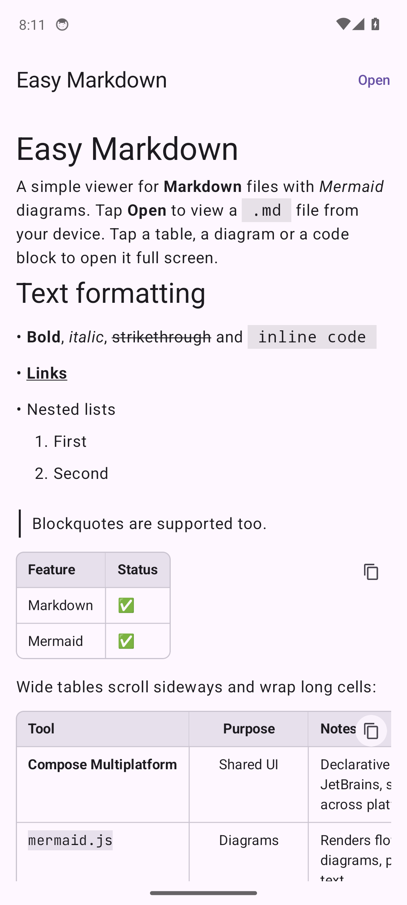
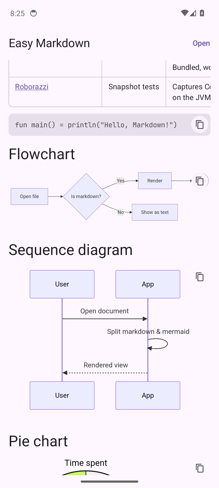
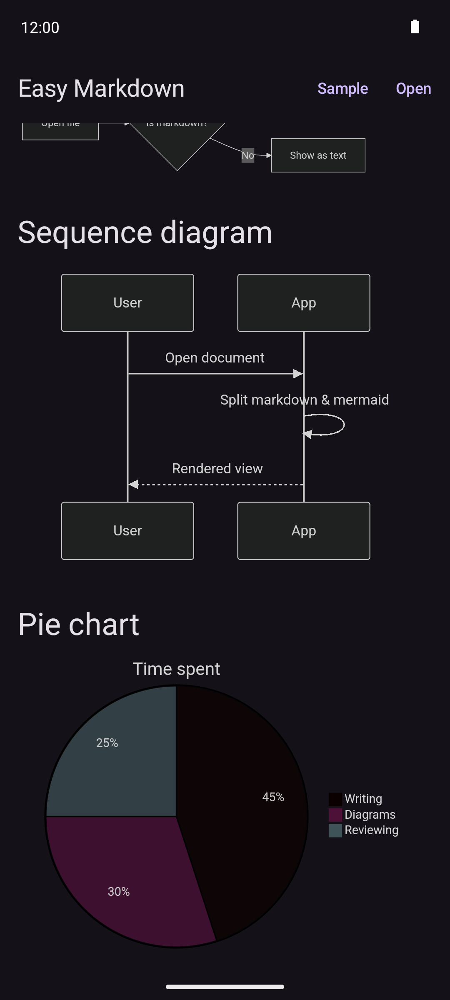
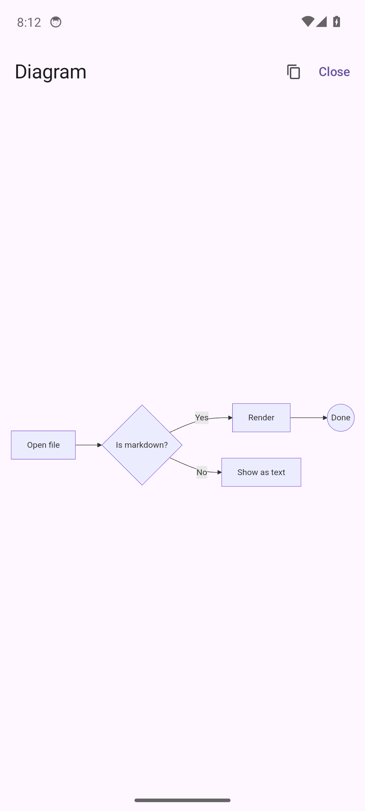
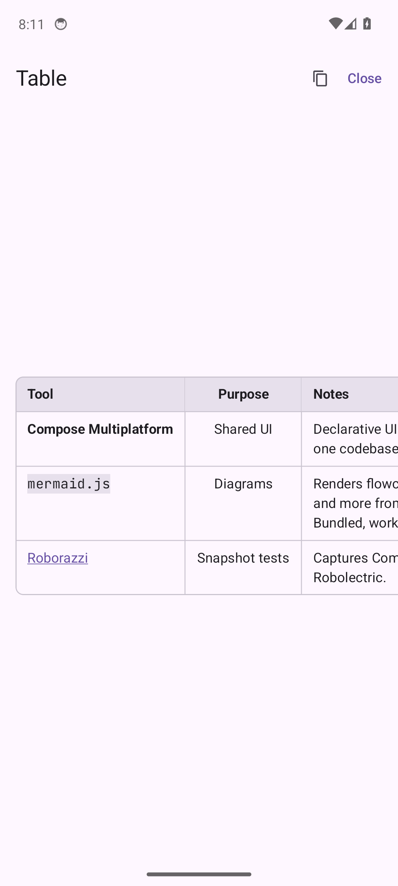
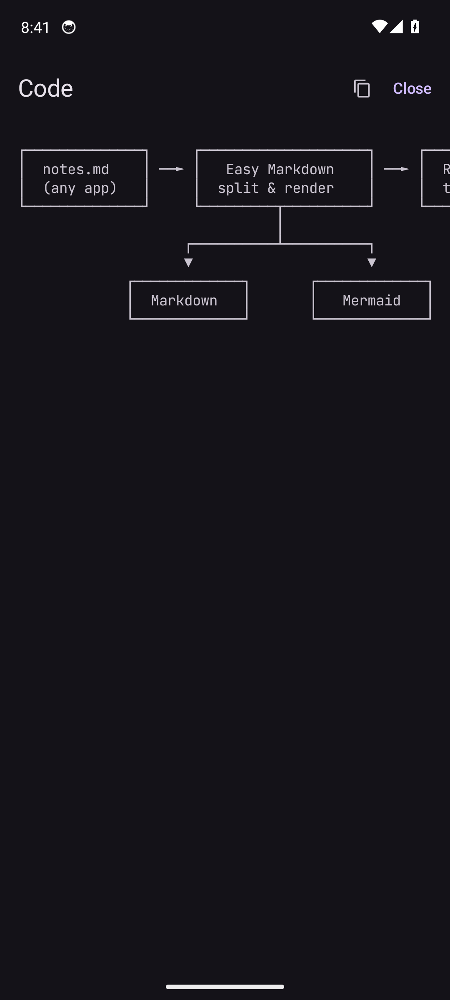
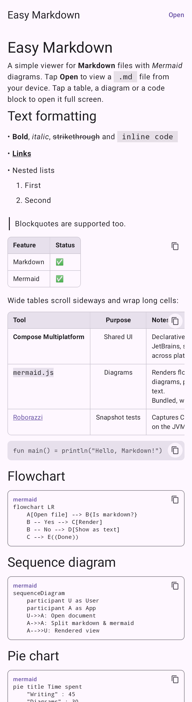

# Easy Markdown

Przeglądarka plików **Markdown** z obsługą diagramów **Mermaid**, napisana w
[Compose Multiplatform](https://www.jetbrains.com/compose-multiplatform/). Działa na Androidzie i macOS.

<p align="center">
  
  
  
</p>
<p align="center">
  
  
  
</p>

## Funkcje

- renderowanie Markdown (nagłówki, listy, tabele, cytaty, bloki kodu, linki) – biblioteka
  [multiplatform-markdown-renderer](https://github.com/mikepenz/multiplatform-markdown-renderer),
- diagramy Mermaid z bloków ```` ```mermaid ```` – renderowane przez dołączony lokalnie
  [mermaid.js](https://mermaid.js.org) (działa offline), z jasnym/ciemnym motywem,
- tabele przewijane w poziomie, z ograniczoną szerokością kolumn (długi tekst się zawija) i formatowaniem
  w komórkach; tapnięcie otwiera tabelę na pełnym ekranie,
- bloki kodu bez zawijania wierszy, z przewijaniem w poziomie i fontem JetBrains Mono (pełny zestaw znaków
  ramek `┌─┐│└┘` i strzałek), więc diagramy ASCII się nie rozjeżdżają; tapnięcie otwiera blok na pełnym ekranie,
- tapnięcie diagramu otwiera go na pełnym ekranie z pinch-to-zoom i przesuwaniem,
- otwieranie plików przez systemowy wybór pliku (**Open**), „Otwórz za pomocą” oraz
  **Udostępnij**; aplikacja rejestruje się jako obsługująca pliki `.md`, `.markdown`, `.mdown`, `.mkd`
  (także gdy menedżer plików podaje ogólny typ MIME), więc można ją ustawić jako domyślną. Przyjmuje udostępniane pliki `.md`/tekstowe oraz sam tekst (renderowany jako Markdown).

## macOS

Aplikacja na Maca (Apple Silicon) do pobrania jako `.dmg` z
[Releases → latest-macos](https://github.com/MikolajKakol/Easy-Markdown/releases/tag/latest-macos)
(lub z **Actions → macOS build → Artifacts** dla dowolnej gałęzi).

1. Otwórz `.dmg` i przeciągnij **Easy Markdown** do **Applications**.
2. Aplikacja nie jest notaryzowana, więc przy pierwszym uruchomieniu macOS ją zablokuje: otwórz
   **Ustawienia systemowe → Prywatność i ochrona** i kliknij **Otwórz mimo to**. Alternatywnie:
   `xattr -dr com.apple.quarantine "/Applications/Easy Markdown.app"`.
3. Przy pierwszym uruchomieniu aplikacja ustawia się jako domyślna dla plików Markdown
   (`.md`, `.markdown`, `.mdown`, `.mkd`), więc `open plik.md` i podwójne kliknięcie w Finderze otwierają
   ją. Gdy później wybierzesz inną aplikację, Easy Markdown tego nie nadpisze – można to przywrócić z menu
   **File → Make Default App for Markdown Files** (albo w Finderze: **Pokaż info → Otwórz za pomocą →
   Zmień wszystko**).

Każdy plik otwiera się w osobnym oknie (ponowne otwarcie tego samego pliku odświeża jego okno).
Skróty: ⌘O otwórz, ⌘R odśwież, ⌘W zamknij okno, Esc zamyka widok pełnoekranowy. Diagram na pełnym
ekranie: przeciąganie lub przewijanie przesuwa, ⌘ + przewijanie przybliża, podwójne kliknięcie dopasowuje.

Diagramy Mermaid renderuje ten sam dołączony mermaid.js w niewidocznym WebView z JavaFX, a wynik
jest pokazywany jako obraz.

## Struktura

```
composeApp/
  src/commonMain       – wspólny UI, podział dokumentu na Markdown i Mermaid
  src/commonTest       – testy jednostkowe parsera
  src/androidMain      – Activity, renderer Mermaid (WebView), assets/mermaid
  src/androidUnitTest  – testy snapshot (Roborazzi + Robolectric)
  src/desktopMain      – aplikacja macOS: okna, renderer Mermaid (JavaFX WebView), domyślna aplikacja
  src/desktopTest      – test renderowania diagramów i zrzuty ekranu wersji desktop
  icons/               – ikona aplikacji macOS
  snapshots/           – wzorcowe obrazy testów snapshot
  debug.keystore       – wspólny klucz debug (APK z CI instalują się jeden na drugim)
docs/screenshots/      – zrzuty z emulatora używane w README
scripts/               – skrypt robiący zrzuty na emulatorze
```

## Budowanie i testy

```bash
./gradlew :composeApp:assembleDebug           # APK: composeApp/build/outputs/apk/debug/
./gradlew :composeApp:testDebugUnitTest       # testy jednostkowe
./gradlew :composeApp:verifyRoborazziDebug    # testy + porównanie snapshotów ze wzorcami
./gradlew :composeApp:recordRoborazziDebug    # nagranie nowych wzorców snapshotów
```

Wymagane JDK 17+ i Android SDK (API 36).

Na Macu:

```bash
./gradlew :composeApp:run                     # uruchomienie wersji desktop
./gradlew :composeApp:desktopTest             # testy, zrzuty w composeApp/build/desktop-screenshots/
./gradlew :composeApp:createDistributable     # Easy Markdown.app w composeApp/build/compose/binaries/
./gradlew :composeApp:packageDmg              # .dmg (bez podpisu)
```

Ustawianie domyślnej aplikacji działa tylko w zbudowanej paczce `.app`, nie przy `run`.

### Testy snapshot

Testy w `AppSnapshotTest` renderują ekran aplikacji w Robolectric i porównują go z obrazami
w [`composeApp/snapshots`](composeApp/snapshots). WebView nie renderuje się pod Robolectric, dlatego
w snapshotach diagramy Mermaid są pokazywane jako ramka z kodem źródłowym – prawdziwe diagramy widać
na zrzutach z emulatora powyżej.



## CI (GitHub Actions)

- **Android build** ([`android.yml`](.github/workflows/android.yml)) – przy każdym pushu i PR-ze:
  testy jednostkowe, weryfikacja snapshotów i debug APK do pobrania w **Actions → Artifacts**.
  Uruchomienie ręczne: *Run workflow*.
- **macOS build** ([`macos.yml`](.github/workflows/macos.yml)) – przy każdym pushu i PR-ze na runnerze
  macOS: testy, aplikacja podpisana ad hoc, `.dmg` w **Artifacts** (z gałęzi domyślnej także w Releases
  jako `latest-macos`) oraz zrzuty ekranu wersji desktop w artefakcie `desktop-screenshots`.
- **Update screenshots** ([`screenshots.yml`](.github/workflows/screenshots.yml)) – uruchamiane ręcznie:
  nagrywa nowe wzorce snapshotów, robi zrzuty ekranu na emulatorze i commituje je na gałąź,
  na której zostało uruchomione. Użyj po zmianach w UI.

Debug APK podpisywane jest kluczem `composeApp/debug.keystore` (hasło `android`), więc kolejne
buildy z CI można instalować bez odinstalowywania poprzedniej wersji.

Licencje dołączonych zasobów (mermaid.js, JetBrains Mono): [`third_party/`](third_party/README.md).

Aktualizacja mermaid.js: podmień `composeApp/src/androidMain/assets/mermaid/mermaid.min.js`
(np. `npm pack mermaid` → `package/dist/mermaid.min.js`).
